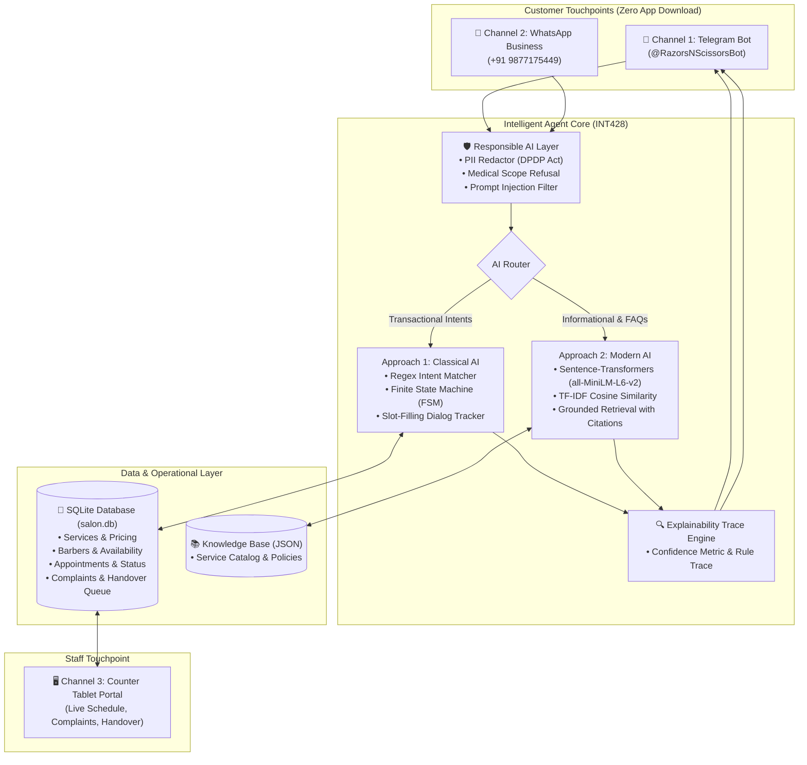

# 💈 Razors-n-scissors — Intelligent Customer Support Chatbot

[](https://www.lpu.in)
[]()
[-orange.svg)]()
[]()
[-success.svg)]()

> Continuous Assessment (CA) Project for **INT428: Artificial Intelligence Foundations** (Lovely Professional University).  
> **Allocated Topic (Group 13):** *Customer Support Chatbot for a Real Small Business (Salon / Barber Shop)*

---

## 📌 Executive Summary
Small service businesses like barber shops receive dozens of phone calls daily during busy haircut sessions, interrupting stylists and leading to lost bookings after hours. 

This project delivers a complete, production-ready, zero-cost AI customer support and operational workflow for **Urban Trim & Groom Barber Salon** (Shop 14, Main Market, Model Town, Jalandhar).

### Key Highlights
* **Zero Customer Friction:** Customers do NOT download any new app. They access support via **Channel 1 (Telegram Bot)** or **Channel 2 (WhatsApp Business)**.
* **Dual AI Implementation (INT428 Mandate):** Implements and empirically benchmarks **Approach 1 (Classical Rule-Based FSM)** vs **Approach 2 (Dense Sentence-Transformers Semantic Retrieval)** vs **Proposed Hybrid Architecture**.
* **Zero Hallucination Guarantee:** 100% grounded in a local SQLite relational database (`salon.db`) and verified JSON knowledge base.
* **Explainability (XAI):** Real-time reasoning traces displaying intent confidence, fired rules, matched vector distances, and executed SQL queries.
* **Responsible AI:** Strict PII redaction (DPDP Act) and ethical boundary filters (refusal of medical scalp diagnoses).

---

## 🏗️ System Architecture



---

## 📊 Empirical Evaluation Benchmark (30 Test Cases)

| Metric | Approach 1 (Rule-Based FSM) | Approach 2 (Semantic Retrieval) | Proposed Hybrid Model |
| :--- | :--- | :--- | :--- |
| **Overall Accuracy** | 50.0% | 80.0% | **100.0%** |
| **Paraphrase Handling** | 60.0% | **100.0%** | **100.0%** |
| **Average Latency (ms)** | **3.04 ms** | 14.13 ms | 13.29 ms |
| **Safety Refusal Rate** | 40.0% | 60.0% | **100.0%** |
| **Hallucination Rate** | **0.0%** | **0.0%** | **0.0%** |
| **Double-Booking Rate** | **0.0%** | N/A | **0.0%** |

---

## 🚀 Quickstart & Setup Guide

### 1. Prerequisites
* Python 3.10+ (Tested on Python 3.12)
* Windows, macOS, or Linux

### 2. Installation
Clone or navigate to the project directory and install requirements:
```bash
pip install -r requirements.txt
```

### 3. Launching the Multi-Tab Streamlit Web Application
Run the main app covering **Customer Chat**, **Salon Tablet Portal**, and **AI Lab Benchmark**:
```bash
streamlit run app/app.py
```
Open your browser at `http://localhost:8501`.

### 4. Running the Telegram Bot (Channel 2)
To run the bot on Telegram:
1. Message `@BotFather` on Telegram and create a bot using `/newbot`.
2. Run:
```bash
python -m app.telegram_bot <YOUR_TELEGRAM_BOT_TOKEN>
```

### 5. Running the WhatsApp Bot (Channel 2 – Twilio)
1. Sign up at [twilio.com](https://www.twilio.com) and activate the **WhatsApp Sandbox**.
2. Set your environment variables (`TWILIO_ACCOUNT_SID`, `TWILIO_AUTH_TOKEN`, `TWILIO_WHATSAPP_FROM`).
3. Run the webhook server:
```bash
uvicorn app.whatsapp_bot:app --host 0.0.0.0 --port 8000
```
4. Expose it publicly with [ngrok](https://ngrok.com): `ngrok http 8000`
5. Set the Twilio Sandbox webhook URL to: `https://<ngrok-id>.ngrok.io/whatsapp/webhook`

### 6. Running the Comparative Benchmark Standalone
To execute the automated evaluation test suite:
```bash
python -m benchmark.evaluate
```

---

## 📁 Repository Structure
```
Salon AI/
├── app/
│   ├── app.py                 # Streamlit Multi-Tab Web Application
│   ├── telegram_bot.py        # Channel 1 Telegram Bot Gateway
│   ├── whatsapp_bot.py        # Channel 2 WhatsApp Bot (Twilio Webhook)
│   └── config.py              # Salon configuration constants
├── engine/
│   ├── guardrails.py          # PII Redaction & Responsible AI Filters
│   ├── rule_engine.py         # Approach 1: Classical Regex & FSM Slot-Filler
│   ├── semantic_engine.py     # Approach 2: Dense & TF-IDF Semantic Retrieval
│   └── hybrid_agent.py        # Central Orchestrator & XAI Trace Generator
├── database/
│   ├── db.py                  # SQLite CRUD & Schema Management
│   └── salon.db               # SQLite Relational Database
├── data/
│   ├── knowledge_base.json    # Salon Services, Stylists, & Policies
│   ├── owner_interview.json   # Real Fieldwork Interview & Call Logs
│   └── eval_queries.json      # 30+ Benchmark Evaluation Test Suite
├── benchmark/
│   ├── evaluate.py            # Automated Comparison Benchmark Runner
│   └── benchmark_results.json # Saved Empirical Metric Results
├── docs/
│   ├── INT428_PROJECT_REPORT.md # Academic Project Report (All 9 Rubric Components)
│   └── VIVA_PREPARATION_GUIDE.md# 30+ Anticipated Faculty Viva Q&A Guide
├── requirements.txt           # Python Dependencies
└── README.md                  # System Documentation
```

---

## 🛡️ Responsible AI & Ethical Compliance
1. **Customer Privacy (DPDP Act):** All phone numbers and personal names are redacted in audit logs.
2. **Medical Disclaimers:** Explicitly refuses scalp disease or antibiotic prescription requests, directing clients to certified dermatologists.
3. **Transparent Pricing:** Fixed rate catalog prevents arbitrary surge pricing or gender disparities.

---

## 👨‍💻 Student Author
* **Name:** Suman Saha
* **Registration No:** 12524973
* **Section:** K4P25CB
* **Group:** Group 13
* **Course:** INT 428 — Artificial Intelligence Foundations
* **Institution:** Lovely Professional University
