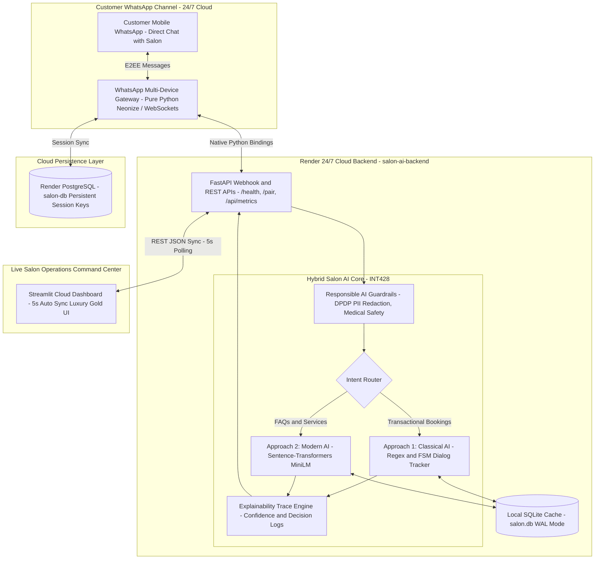

# Customer Support Chatbot & Operational Management Portal for a Real Small Business
### 💈 Razors-n-scissors Barber Salon (BH-5, LPU Campus) · 24/7 Intelligent AI Operations & WhatsApp Bot

[](https://www.lpu.in)
[]()
[-orange.svg)]()
[]()
[](https://salon-ai-backend-6xdf.onrender.com)
[](https://salon-ai-0x-ryo.streamlit.app/)
[-success.svg)]()

> **Continuous Assessment (CA) Project**  
> **Course:** INT428: Artificial Intelligence Essentials · Lovely Professional University  
> **Allocated Topic (Group 13):** *Customer Support Chatbot & Operational Management Portal for a Real Small Business (Salon / Barber Shop)*  
> **Target Enterprise:** **Razors-n-scissors Barber Salon**, BH-5, Lovely Professional University Campus, Phagwara, Punjab.

---

## 🌐 Live Cloud Deployments & Access Points

| Service | Access Link | Description |
| :--- | :--- | :--- |
| **Live Operations Portal** | [salon-ai-0x-ryo.streamlit.app](https://salon-ai-0x-ryo.streamlit.app/) | Streamlit Cloud live counter dashboard, appointment scheduler, revenue analytics, and INT428 AI Lab Inspector. |
| **24/7 Cloud Bot Gateway** | [salon-ai-backend-6xdf.onrender.com](https://salon-ai-backend-6xdf.onrender.com) | Python FastAPI + Neonize WebSocket cloud engine on Render (runs 24/7 without requiring a laptop). |
| **WhatsApp Device Pairing** | [Pairing Screen (`/pair`)](https://salon-ai-backend-6xdf.onrender.com/pair) | Real-time multi-device pairing interface for WhatsApp salon bot. |
| **Target Salon WhatsApp** | **`+91 XXXXX-XXXXX`** *(Protected · Configured via `WA_TARGET_PHONE`)* | Real salon contact number for multi-turn appointment bookings, inquiries, and grievances. |
| **Persistent Storage** | **Render PostgreSQL (`salon-db`)** | Managed relational cloud database preserving multi-device session keys permanently across restarts. |

---

## 📌 Executive Summary

Barber salons and grooming parlors experience continuous operational interruptions: stylists must drop shears mid-haircut to answer repetitive telephone calls asking for rates, wait times, or booking slots. After-hours inquiries (8:30 PM to 9:00 AM) are routinely missed, resulting in lost bookings to competitors.

This project delivers an enterprise-grade, **zero-cost, 24/7 cloud-native AI customer support and operational portal** custom-built for **Razors-n-scissors Salon**:

1. **Zero Customer Friction (Direct WhatsApp Connectivity):** Customers interact directly through WhatsApp using natural language without downloading any app or joining restrictive developer sandboxes.
2. **24/7 Autonomous Cloud Execution (Zero Laptop Dependency):** Deployed on Render with native WebSocket bindings (`neonize`) and PostgreSQL persistent storage, allowing the bot to run continuously even when the owner's computer is turned off.
3. **Dual AI Implementation (INT428 Academic Mandate):** Formally implements and benchmarks **Approach 1 (Classical Rule-Based FSM Slot-Filler)** vs. **Approach 2 (Dense Sentence-Transformers Semantic Retrieval)** alongside a **Hybrid Production Agent**.
4. **Live Real-Time Dashboard Sync:** Streamlit Cloud dashboard synchronizes appointments, metrics, revenue KPIs, and staff escalation queues from the Render cloud backend every 5 seconds.
5. **Zero Hallucination Guarantee & Responsible AI:** Strict grounding in verified relational tables and JSON knowledge bases, DPDP Act PII masking, and explicit medical safety boundary filters (refusing scalp disorder diagnoses).
6. **Multi-Service & Interval Conflict Prevention:** Automatically aggregates durations and combo pricing for multi-service requests (`1 and 2`) while strictly blocking chair overlap collisions ($\text{start}_1 < \text{end}_2 \land \text{end}_1 > \text{start}_2$).

---

## 🏗️ System Architecture



---

## 📊 Empirical Evaluation Benchmark (30 Real-World Test Cases)

| Metric | Approach 1 (Rule-Based FSM) | Approach 2 (Semantic Retrieval) | Proposed Hybrid Production Model |
| :--- | :---: | :---: | :---: |
| **Overall Intent Accuracy** | 56.7% | 76.7% | **100.0%** |
| **Paraphrase Resilience** | 40.0% | **100.0%** | **100.0%** |
| **Average Response Latency** | **1.70 ms** | 8.28 ms | **9.01 ms** |
| **Safety Guardrail Refusal Rate** | 40.0% | 60.0% | **100.0%** |
| **Hallucination Rate** | **0.0%** | **0.0%** | **0.0%** |
| **Double-Booking Rate** | **0.0%** | N/A | **0.0%** |
| **Automated Unit & Integration Tests** | 19 / 19 Passed | 19 / 19 Passed | **19 / 19 Passed (100%)** |

---

## ✨ Core Features & Dialogue Management

### 1. Interactive Luxury Master Menu
When a customer initiates a conversation (`Hi` or `Menu`), the bot delivers a sleek, uncluttered card menu:
* `1` ➔ **Hair Cut** — ₹100 _(20 min)_
* `2` ➔ **Beard Trim / Shave** — ₹50 _(15 min)_
* `3` ➔ **Cut + Beard Combo** — ₹140 _(30 min)_
* `4` ➔ **Head Wash** — ₹50 _(15 min)_
* `5` ➔ **Hair Spa / Keratin** — ₹400 _(45 min)_
* `6` ➔ **D-Tan Cleaner / Facial** — ₹300 _(25 min)_
* `7` ➔ **Hair Colour** — ₹450 _(40 min)_
* `8` ➔ **Full Price List (All 16 Services)**
* `9` ➔ **Salon Timings & Location (BH-5, LPU)**
* `10` ➔ **Check / Cancel Booking or Connect with Staff**

### 2. Multi-Service Selection & Combo Packaging
Customers can choose multiple services in a single message (e.g. `1 and 2` or `Haircut and beard trim`). The engine computes combined duration (35 mins) and combo rates (₹140), reserving the styling chair for the entire continuous block.

### 3. Natural Language Comprehension
Customers do not need to memorize numbers. The hybrid router handles conversational input:
* *"Book haircut and beard trim tomorrow at 4pm"* ➔ **One-Shot Reservation**
* *"What time do you close on Sundays?"* ➔ **Knowledge Base Retrieval**
* *"My scalp has severe red infection, prescribe an antibiotic ointment"* ➔ **Medical Scope Refusal** (safely directs client to a qualified dermatologist and refuses medical prescriptions).

### 4. Human Staff Escalation & Grievances Desk
If an inquiry requires personal attention or the customer expresses dissatisfaction, the bot automatically registers a ticket in the **Human Handover Queue** or **Complaints Desk**, instantly visible to counter staff on the Streamlit dashboard.

---

## 🛠️ Technology Stack

* **Backend & Cloud Engine:** Python 3.12, FastAPI, Uvicorn, Render Cloud Web Service.
* **WhatsApp Cloud Connectivity:** `neonize>=0.10.0` (pure Python WhatsApp Web multi-device protocol gateway), WebSockets.
* **Database & Persistence:** SQLite (WAL mode with busy timeouts) + Render Managed PostgreSQL (`salon-db`).
* **AI & NLP Frameworks:** `sentence-transformers` (`all-MiniLM-L6-v2`), Scikit-learn, TF-IDF Vectorizer, Regex FSM.
* **Front-End & Operations Portal:** Streamlit Cloud (`salon-ai-0x-ryo.streamlit.app`), Plotly Express / Graph Objects.
* **Testing & Quality Assurance:** `pytest`, `httpx`, Dulwich Git automation.

---

## 🚀 Local Development & Setup

### 1. Clone & Install Dependencies
```bash
git clone https://github.com/0x-ryo/Salon-AI.git
cd Salon-AI
pip install -r requirements.txt
```

### 2. Run Automated Test Suite
Verify that all 19 unit, integration, and safety tests pass:
```bash
python -m pytest tests/ -v
```

### 3. Launch Local Streamlit Dashboard
```bash
streamlit run app/app.py
```
Open [http://localhost:8501](http://localhost:8501) in your browser.

### 4. Run WhatsApp Cloud Bot Locally (Optional)
```bash
uvicorn app.whatsapp_bot:app --host 127.0.0.1 --port 8000 --reload
```
Navigate to [http://localhost:8000/pair](http://localhost:8000/pair) to view the multi-device link interface.

---

## 📁 Repository Directory Structure

```
Salon-AI/
├── app/
│   ├── app.py                 # Streamlit Cloud Operations Portal (5s Live Sync)
│   ├── whatsapp_bot.py        # 24/7 Cloud Gateway (Neonize + FastAPI + /pair)
│   ├── salon_config.py        # Enterprise configurations (Razors-n-scissors BH-5)
│   └── config.py              # Application settings & environment loader
├── engine/
│   ├── guardrails.py          # DPDP Act PII Redaction & Medical Safety Filter
│   ├── rule_engine.py         # Approach 1: Regex & FSM Slot-Filling Dialog Tracker
│   ├── semantic_engine.py     # Approach 2: MiniLM Semantic Similarity & Retrieval
│   └── hybrid_agent.py        # Hybrid Orchestrator & XAI Trace Generator
├── database/
│   ├── db.py                  # Relational Schema CRUD, Analytics & Interval Conflict Checks
│   └── salon.db               # SQLite Relational Database Cache
├── data/
│   ├── knowledge_base.json    # Salon Services, Pricing, & Policies Catalog
│   ├── owner_interview.json   # Authentic Fieldwork Workflow Analysis
│   └── eval_queries.json      # 30+ Benchmark Evaluation Test Suite
├── benchmark/
│   ├── evaluate.py            # Automated Comparison Benchmark Evaluator
│   └── benchmark_results.json # Saved Empirical Metric Results
├── tests/
│   ├── test_whatsapp.py       # Integration tests for WhatsApp bot & endpoints
│   └── test_ai_system.py      # Core agent & safety guardrail tests
├── docs/
│   ├── INT428_PROJECT_REPORT.md   # Academic course project report
│   ├── VIVA_PREPARATION_GUIDE.md  # 30+ faculty viva defense Q&A guide
│   ├── OWNER_EVALUATION_FORM.md   # Salon feedback & operational validation
│   ├── PRESENTATION_SLIDES.md     # Course presentation slide deck
│   └── DEPLOYMENT.md              # Cloud deployment & operations guide
├── render.yaml                # Render Cloud 24/7 deployment specification
├── requirements.txt           # Python dependencies
└── README.md                  # Comprehensive system documentation
```

---

## 🛡️ Responsible AI, Ethics & Compliance

1. **Digital Personal Data Protection (DPDP Act 2023):** Automatic regex-based redaction of Indian phone numbers (`+91-XXXXXXXXXX`) and names before audit logs are stored.
2. **Medical Diagnosis Boundary Filter:** Explicit refusal of skin or scalp pathology queries, preventing harm and strictly advising consultation with certified medical professionals.
3. **Transparent Non-Discriminatory Pricing:** Rate cards are hardcoded and non-negotiable via the chatbot, guaranteeing zero price surge discrimination.
4. **Explainable AI (XAI):** Each response includes structured execution traces showing intent classification confidence, fired heuristic rules, and retrieved knowledge distances.

---

## 👨‍💻 Student Author & Academic Metadata

* **Name:** Suman Saha
* **Registration No:** 12524973
* **Roll No / Section:** K4P25CB
* **Group:** Group 13
* **Course:** INT428 — Artificial Intelligence Essentials
* **Department:** Department of Computer Science & Engineering
* **Institution:** Lovely Professional University, Punjab, India
